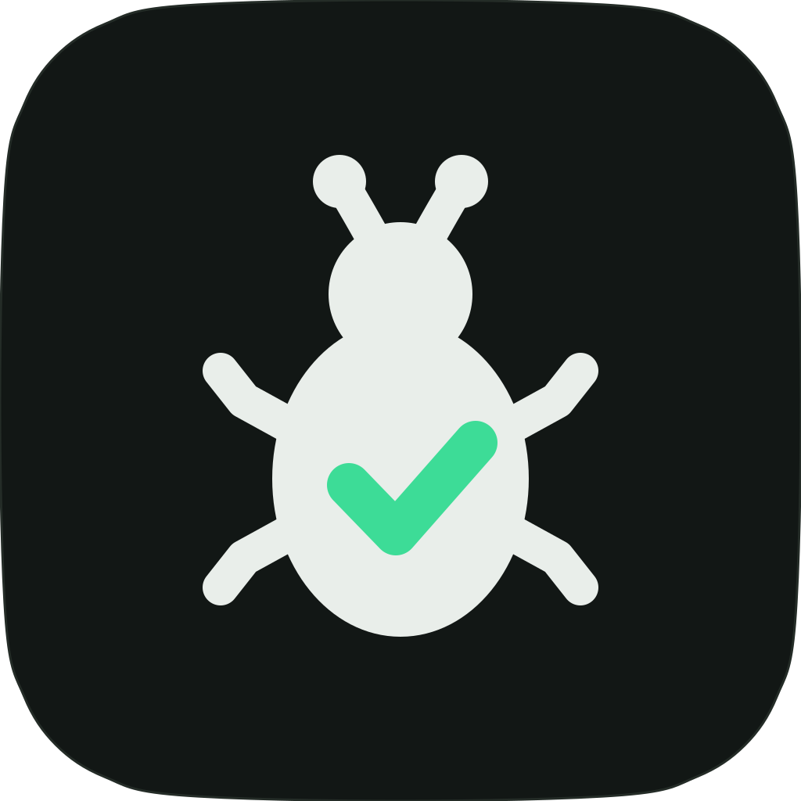
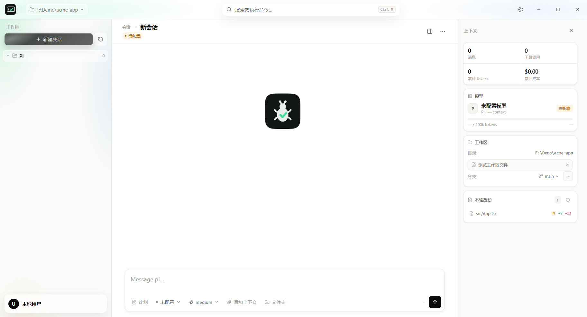
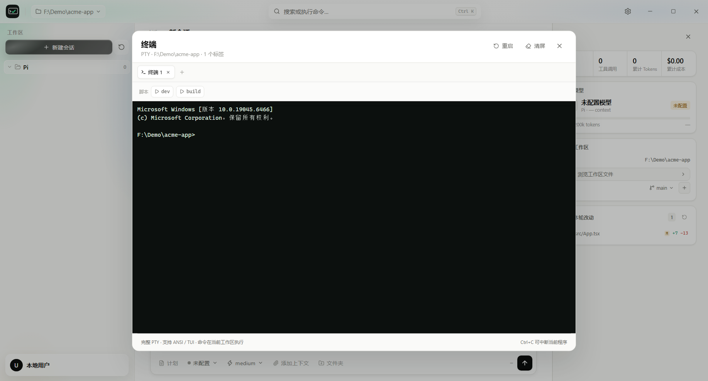
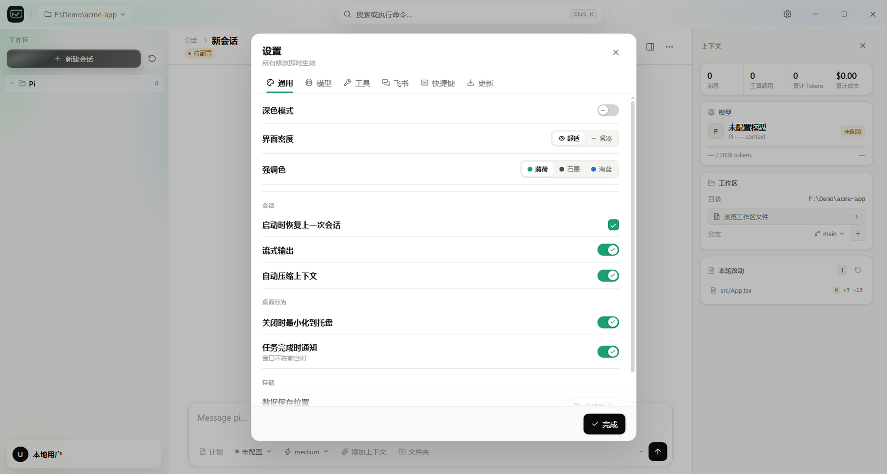

<p align="center">
  
</p>

<h1 align="center">TesT</h1>

<p align="center">
  Windows 上的 AI 编程工作台：对话、终端、文件、Git 和远程协作，集中在一个桌面窗口里。
</p>

<p align="center">
  React 19 · Vite · Electron 44 · Pi RPC · Windows x64
</p>



## 它是什么

TesT 是面向 Pi 编码代理的 Windows 桌面客户端。它把一次完整的本地开发流程放进同一个窗口：管理多个工作区与会话、调用模型、查看工具执行、编辑文件、运行终端命令、检查 Git 改动，并把当前工作区安全地共享到手机浏览器。

项目采用 Electron 主进程 + preload IPC + React 渲染层，Pi 通过 RPC sidecar 运行。数据默认保存到独立目录，安装程序与便携版都支持首次启动时选择数据位置。

## 核心功能

- **多会话 AI 对话**：流式输出、思考等级、模型切换、上下文引用、消息编辑与会话恢复。
- **完整终端**：基于 `node-pty` 与 xterm.js 的多标签 PTY，支持 ANSI/TUI、脚本快捷运行和输出留存。
- **工作区与文件**：工作区切换、文件树、只读预览、拖入上下文、路径搜索。
- **Git 工作流**：状态、diff、暂存、提交、分支切换、逐块暂存/还原、Worktree 创建与合并。
- **模型管理**：Pi 模型目录、Provider 登录、模型能力搜索、本地模型预设与自定义端点。
- **自动更新**：默认从 GitHub Releases 检查更新，也支持自定义 generic feed。
- **桌面体验**：深浅色、密度、强调色、快捷键、托盘、通知、多窗口与跨窗口会话同步。
- **远程访问**：局域网二维码、临时公网隧道、Tailscale 地址发现，以及适配手机的 Web 界面。
- **飞书接入**：可选的长连接机器人，将工作区对话接入飞书群聊。
- **可迁移数据目录**：安装位置和数据位置分离；设置内可迁移数据目录。

## 界面

| 内置终端 | 设置与数据目录 |
| --- | --- |
|  |  |

## 下载

请前往 [GitHub Releases](../../releases/latest) 下载 Windows x64 版本：

- `TesT-Setup-*.exe`：安装版，可自定义安装目录。
- `TesT-Portable-*.exe`：便携版，数据默认放在 EXE 同目录的 `TesTData`。

首次启动会要求选择数据目录。会话、认证信息、模型配置和扩展都保存在该目录中，不会写入代码仓库。

> 当前构建未进行商业代码签名，Windows SmartScreen 可能显示提示。

## 本地开发

需要 Node.js 24+、npm 和 Windows 10/11。

```powershell
git clone https://github.com/SgF-123/TesT.git
cd TesT
npm install
npm run dev
```

启动 Electron：

```powershell
npm run electron:dev
```

构建安装版与便携版：

```powershell
npm run dist
```

打包脚本默认从同级目录 `..\pi\packages\coding-agent\dist\bundle` 读取 Pi bundle；也可以通过 `TEST_PI_BUNDLE` 指向其他位置。

## 架构

```text
React + Vite renderer
        │ window.tesT
        ▼
Electron preload (contextBridge)
        │ IPC
        ▼
Electron main
  ├─ Pi RPC sidecar
  ├─ node-pty terminal
  ├─ Git / files / worktrees
  ├─ Feishu channel
  └─ remote web server
```

更详细的设计说明见 [docs/ARCHITECTURE.md](docs/ARCHITECTURE.md) 与 [DESIGN.md](DESIGN.md)。

## 安全

- 渲染层启用 `contextIsolation`、`sandbox`，关闭 `nodeIntegration`。
- 外部链接只通过系统浏览器打开。
- API Key、登录凭证和飞书密钥不会写入仓库。
- 远程访问使用临时访问令牌；公网隧道可随时停止。

发现安全问题请参阅 [SECURITY.md](SECURITY.md)。

## License

[MIT](LICENSE)
